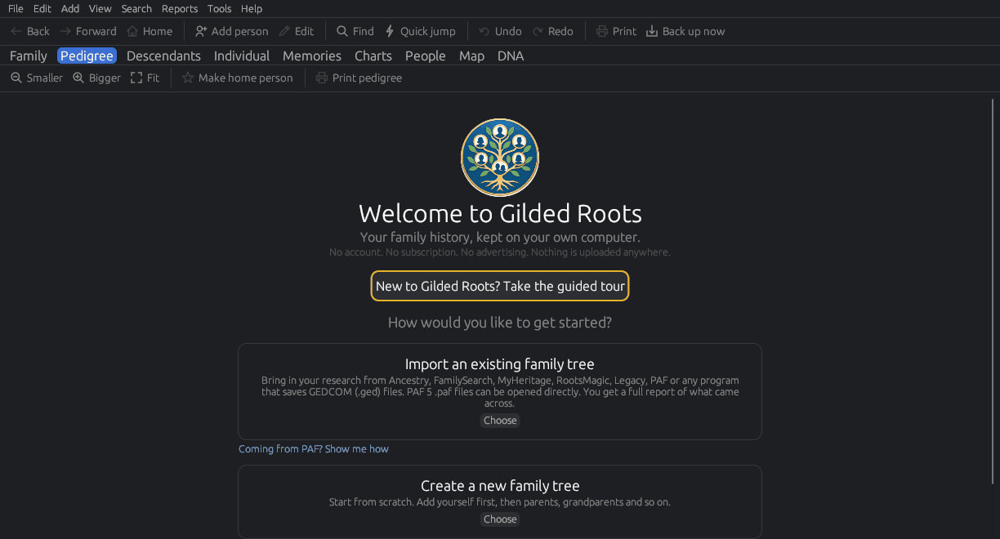
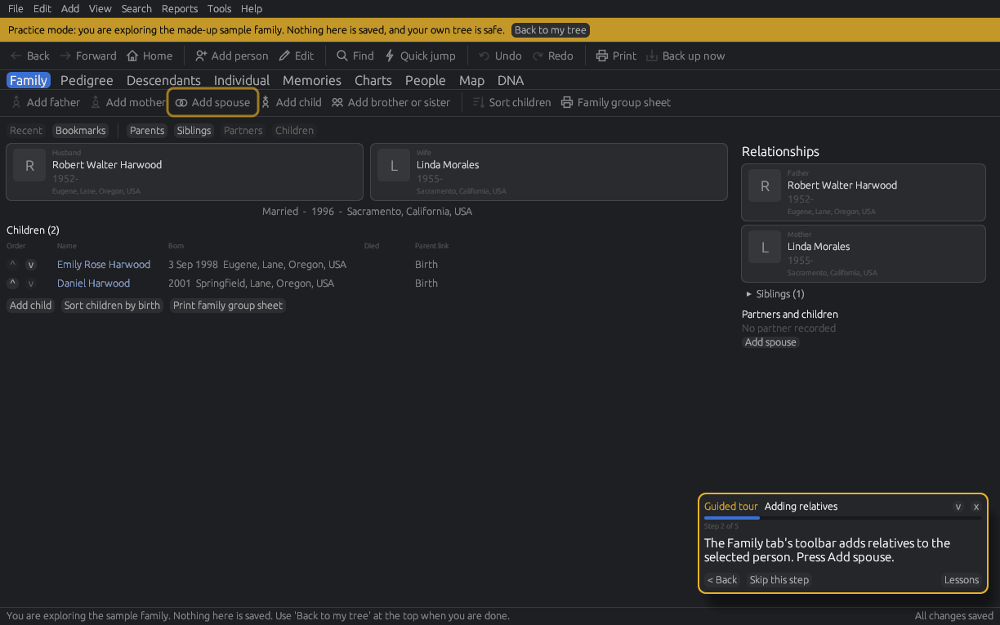
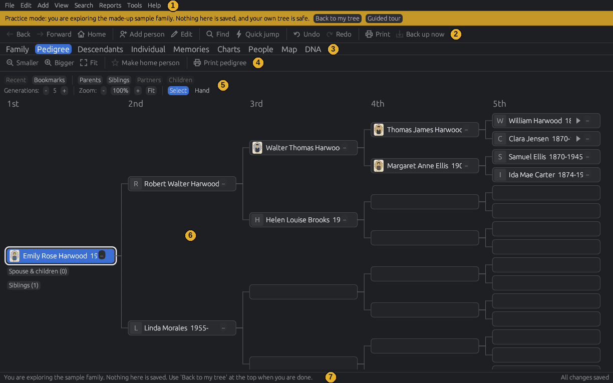
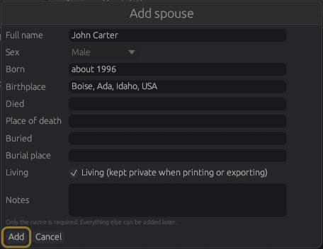
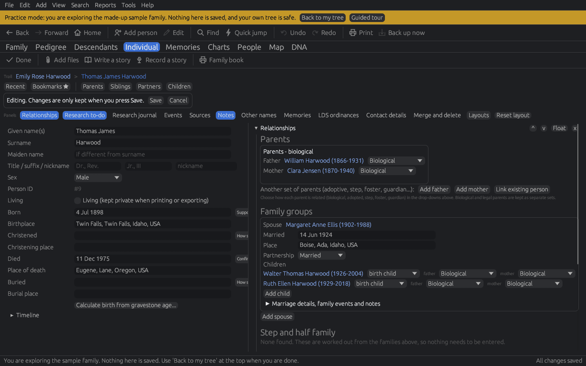
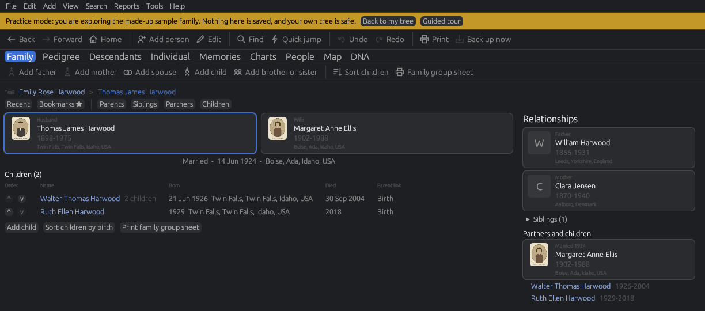
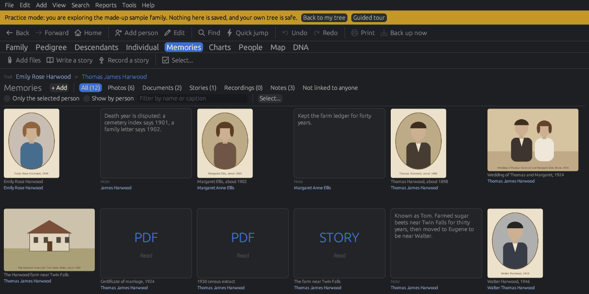

# Gilded Roots user guide

# Getting started

## How to use this guide
This guide is built into the program: press **F1** (or **Help → User guide**; on a Mac **Cmd+?**) to open it at
any time, even without the internet. The parts and chapters are listed on the left; click one to go there. Type in
the **Search** box to keep only the chapters that mention a word, such as "merge" or "census".

New to Gilded Roots? Read [Your first family tree, step by step](#your-first-family-tree-step-by-step), or take
the **guided tour** (Help → Tutorials), which shows you what to press on a made-up practice family.

See also: [The guided tour](#the-guided-tour) [The screen at a glance](#the-screen-at-a-glance) [Keyboard shortcuts](#keyboard-shortcuts)

## Installing Gilded Roots
Download the file for your computer from the **Releases** page of the Gilded Roots project on GitHub. There is one
download for each kind of computer, plus a README (a PDF) explaining how to open it.

- **Windows 10 or 11:** `GildedRoots-Windows-Setup.exe`. Run it and choose **Install on this computer**. Windows
  may warn that the program is from an unknown publisher (Gilded Roots is free and not signed with a paid
  certificate): choose **More info**, then **Run anyway**.
- **Mac (macOS 11 or newer, Apple chip or Intel):** `GildedRoots-Mac.dmg`. Open it and drag **Gilded Roots** into
  **Applications**. The first time, macOS may say it cannot check the app: open it once, then choose **System
  Settings → Privacy & Security → Open Anyway**. On macOS 14 or older, right-click the app and choose **Open**
  instead.
- **Linux (64-bit):** `GildedRoots-Linux.tar.gz`. Unpack it and run `./install.sh`.

Each download also has a **portable** copy that runs from a USB drive and keeps everything beside it: see
[Portable use (USB drive)](#portable-use-usb-drive).

Gilded Roots needs no account or subscription and never asks for a password. Your tree is kept in a folder called
**Gilded Roots** in your Documents folder.

## The first screen
When there is no tree yet, the welcome screen offers:

- **New to Gilded Roots? Take the guided tour:** short lessons on a practice family (see
  [The guided tour](#the-guided-tour)).
- **Import an existing family tree** from Ancestry, FamilySearch, MyHeritage, RootsMagic, Legacy, PAF or any
  program that saves GEDCOM (.ged) files. PAF 5 files (.paf) can be opened directly. See
  [Bringing in a tree from another program](#bringing-in-a-tree-from-another-program).
- **Create a new family tree** and add yourself first.
- **Open a Family Tree Archive** made on this or another computer.
- **Explore the sample family first:** look around a made-up family without changing anything of yours.

## The guided tour
**Help → Tutorials** lists the lessons of the guided tour; pick one to start it, or choose **Guided tour** to see
them all (also on the welcome screen, in the gold practice bar and at the top of this guide). The tour teaches
the program in short lessons:

1. **Finding your way around:** the pedigree chart, a person's page, the Family tab, Home and Quick jump.
2. **Adding relatives:** a husband for Emily, and a child for them both.
3. **Changing facts:** unlock a page, change something, save it, and undo it.
4. **Photos, documents and stories:** a photo with tagged faces, and a document in the built-in reader.
5. **Charts and printing:** the fan chart and lifespans, and printing a chart.
6. **The map:** watch the family move over the years.
7. **Starting your own tree:** leave the practice family and begin with yours.

Each lesson uses the made-up Harwood family, so nothing you do is saved and your own tree is not touched. A card
in the bottom-right corner says what to do next, and a gold outline shows the button to press. When you have done
it, the card says **Well done!** and moves on by itself. **Skip this step** moves on without doing it, **< Back**
goes back a step, **v** folds the card out of the way, and **x** ends the tour. **Lessons** lists them all, with a
tick beside the ones you have finished. **Help → Tutorials** also opens the chapter
[Your first family tree, step by step](#your-first-family-tree-step-by-step).

## The sample family (practice mode)
**Help → Explore the sample family** opens the made-up Harwood family: six generations from England, Denmark and the
American West, with photos, a tagged wedding photo, sources, a marriage certificate and census page (PDFs), a story,
research tasks, journal entries, confidence ratings and places for the map. A gold bar at the top says you are in
practice mode. Try anything: nothing is saved, and your own tree is not touched. Press **Back to my tree** when done.

## The screen at a glance

1. **Menus:** File, Edit, Add, View, Search, Reports, Tools and Help. Everything the program does is in a menu.
2. **Main toolbar:** Back, Forward, Home, Add person, Edit, Find, Quick jump, Undo, Redo, Print and Back up now.
   It is the same on every tab.
3. **Tabs:** Family, Pedigree, Descendants, Individual, Memories, Charts, People, Map and DNA. Each shows your tree
   a different way (Ctrl+1 to Ctrl+9; Cmd on a Mac).
4. **Tab toolbar:** buttons for the tab that is open, such as **Add father** on the Family tab.
5. **Getting around:** the trail of people you have visited, Recent, Bookmarks, and buttons listing the selected
   person's parents, brothers and sisters, partners and children.
6. **The chart or page itself.** Click a person to highlight them; double-click to open their page.
7. **Status bar:** what just happened, and whether your changes are saved.

Hover over any button to see what it does and its keyboard shortcut.

See also: [Toolbars](#toolbars) [Moving around the tree](#moving-around-the-tree)

## Your first family tree, step by step
This chapter starts a tree from nothing. It takes about half an hour, and every step can be undone.

1. **Start the tree.** On the welcome screen choose **Create a new family tree**. (Already have a tree in another
   program? Bring it in instead: see [Bringing in a tree from another program](#bringing-in-a-tree-from-another-program).)
2. **Add yourself.** The Add person window opens. Type your full name, choose your sex, and fill in your birth date
   and birthplace if you like. Only the name is needed; tick **Living** so your details stay private on paper.
   Press **Add**. To make sure the charts always start from you, open the **Pedigree** tab and press **Make home
   person** on its toolbar (it is greyed out if you already are).
3. **Add your parents.** Open the **Family** tab and press **Add father** on its toolbar. Type his name and what you
   know, and press **Add**. Do the same with **Add mother**. They are linked to you, and to each other as a couple.
4. **Keep going back.** Click your father's card, then **Add father** and **Add mother** again for his parents.
   On the **Pedigree** tab, clicking an empty box also adds a father or mother there.
5. **Add brothers, sisters and children.** On the Family tab, **Add brother or sister** and **Add child** do just
   that. **Add spouse** adds a husband, wife or partner.
6. **Fill in the details.** Double-click anyone to open their **Individual** page. It is locked, so nothing changes
   by accident: press **Edit**, add dates, places, occupation and notes, then press **Save**. Dates can be written
   the way you know them: "12 Mar 1921", "about 1850", "before 1900".
7. **Say where it came from.** Turn on **Sources** in the Panels row above the Individual page. While editing,
   press **Add source**, pick a source you have used before or add a new one (the census, the certificate, the
   family Bible), choose which fact it backs up, and type the page. See [Sources and citations](#sources-and-citations).
8. **Add a photo or document.** On the Individual page press **Add files** and choose a photo, a scan or a PDF. It
   is copied into your tree's folder, so the original can stay where it is.
9. **Print a chart.** Open the **Pedigree** tab and press **Print** on the toolbar. The chart opens in your web
   browser, ready to print or to save as a PDF.
10. **Keep a copy safe.** Gilded Roots saves every change by itself and makes a backup each day. For a copy you can
   keep anywhere, choose **File → Save Family Tree Archive**, and put it on a USB drive or another computer. See
   [Keeping your tree safe](#keeping-your-tree-safe).

Made a mistake? **Undo** (Ctrl+Z; Cmd+Z on a Mac) takes back the last change, as many times as you need.

## Bringing in a tree from another program
Choose **Import an existing family tree** on the welcome screen, or **File → Import tree...** at any time, and pick
the file.

**From PAF.** PAF 5 files (.paf) can be imported directly, without PAF: names, sex, births, deaths, marriages,
husbands, wives and children in PAF's order come across. Christenings, burials, LDS ordinances, notes, sources and
photos can't be read from a .paf file yet; if your file has any, the import report says so. For those, use the full
way: in PAF choose **File → Export**, pick **GEDCOM 5.5** and tick notes, sources and multimedia links, save the .ged
file (keep any photo folder next to it), then import that file here. **Coming from PAF? Show me how** on the welcome
screen gives the same steps.

**From anything else.** Export a GEDCOM (.ged) file from the other program or website (Ancestry, FamilySearch,
MyHeritage, RootsMagic, Legacy, Gramps and others all can), then import it here.

**Import options.** Gilded Roots reads the file and shows what is in it (people, families, sources, citations,
notes, events, photos and documents, links to photos on websites, LDS ordinances, living people, research tasks and
the program it came from) before anything comes in. Then choose:
- **Where:** add it to your tree (you check every possible match), replace your tree with it (a backup is made
  first), or put it in **a new tree of its own** (kept under File → Family trees; your open tree is saved and left
  as it is).
- **People:** everyone, or the ancestors, descendants, or ancestors and descendants of one person (type a name to
  choose them), and whether to **leave out living people** (people marked living, or with no death or burial and
  born in the last 110 years).
- **What to include:** notes; sources and citations; photos and documents found with the file; links to photos on
  websites (Ancestry, MyHeritage); LDS ordinances; addresses and contact details; research tasks; and other details
  only the program that made the file understands.
- **Places:** tick the box to open the Places window afterwards and tidy place names.

A sentence under the choices says what will happen ("3 people will go in a new tree called..."). Your choices are
remembered for next time, and the file itself is never changed.

After an import, read the **Import report**: it counts the people, families, sources, citations, notes and photos
that came across and lists anything that could not be carried over.

See also: [Importing from Ancestry](#importing-from-ancestry) [Merging duplicates](#merging-duplicates) [Separate family trees](#separate-family-trees)

## Importing from Ancestry
Ancestry's GEDCOM files contain links to the photos on Ancestry's website, not the photos themselves. Gilded
Roots keeps every link, writes it back when you export, and shows **Open online** next to it (photos appear in
Memories as "Photo stored online"). To have the pictures on your computer, download them from Ancestry and add
them with **Add files**. If you don't want the links, **Remove online links...** on the Memories tab takes them all
off at once. Dates Ancestry writes in other styles (such as "FEB 8 1891" or "13 SEPTEMBER, 1713") are tidied into
standard form.

# Everyday work

## Moving around the tree
- **Click** a person in any chart to highlight them; **double-click** to open their Individual page.
- **Home person:** the **Home** button (or the Home key) goes back to the home person, the one the charts start
  from. To choose another, use **Tools → Home person...**, or right-click a person and choose **Make this the home
  person**. Each tree keeps its own home person; an imported tree brings its home person with it.
- **Back and Forward** on the main toolbar step through the people you have looked at.
- **Trail:** the line above the chart lists people you have visited. Click a name to return to it.
- **Recent** (above the chart) lists the last 15 people you looked at.
- **Bookmarks:** mark people you come back to often (**Bookmarks → Bookmark this person**, or right-click a box).
  They are listed under Bookmarks, first in Quick jump, and in the People table's Show filter.
- **Parents / Siblings / Partners / Children:** buttons above the chart list the selected person's relatives.
  Adoptive, step and foster parents and half-siblings are listed too.
- **Keyboard:** Right arrow = father (Shift = mother), Left arrow = a child (the one you came from, if any),
  Up/Down = previous/next brother or sister, Home = home person. Arrow keys are ignored while you type.
- The selected person has a bold outline; a clicked (highlighted) person has a thick coloured border.

See also: [Quick jump](#quick-jump) [Pedigree box actions](#pedigree-box-actions) [Large trees](#large-trees)

## Quick jump
Press **Ctrl+K** (Windows/Linux) or **Cmd+K** (Mac), or **F4**, or the **Quick jump** button, from anywhere. Type
part of a name, a year, an ID (`#123`) or what you want to do ("add spouse", "places", "export"). Use the arrow keys
to choose and **Enter** to go; **Esc** closes it. With nothing typed it shows your bookmarked people and every
command. A number on its own finds that ID first.

## Pedigree box actions
Every box on the pedigree has a portrait (or the person's initial) to the left of the name and a **...** button on
the right; right-clicking a box opens the same menu:
- **Open individual page**
- **View their tree**: ancestors (pedigree), descendants, or family, centred on that person
- **Quick edit...**: a small window for name, sex, birth, death and living, with Save and Cancel
- **Add a relative**: father, mother, another set of parents, brother or sister, spouse, or child
- **Show which parents** (when someone has more than one set, such as birth and adoptive parents)
- **Centre chart on this person**, **Make this the home person** and **Bookmark this person**

**Select and Hand:** the toolbar above the pedigree and descendant charts has **Select** (click people as usual)
and **Hand**. With the hand on, drag anywhere on the chart to move it around (the pointer becomes a hand), and
clicks never change who is selected by accident. Press **H** to switch between the two; the choice is remembered.

Under the main person (generation 1) there are two drop-downs: **Spouse & children** and **Siblings**. Pick a
name to move the chart to them, or use the Add entries at the bottom. The descendants chart has the same
right-click menu. **Smaller**, **Bigger** and **Fit** on the tab toolbar change the size of the chart.

## Adding people
Use the **Add** menu (Individual, Spouse, Father, Mother, Child, or **Another set of parents**), the **Add person**
button, or the Family tab's toolbar (**Add father**, **Add mother**, **Add spouse**, **Add child**, **Add brother or
sister**). The Add window asks for the name, sex, birth, death, burial, living status and notes, so you can fill a
person in at once. Only the name is required. The new person is linked to the selected person straight away.

## Editing a person
Click a name in any chart to select it. The **Individual** page opens **locked** so a stray keystroke cannot change
your tree. Press **Edit** to unlock it, make your changes, then press **Save**. **Cancel** puts the person back
exactly as they were. While locked, the page reads like a profile: portrait, name and dates at the top, then only the
facts that are filled in, with relatives as clickable links. If you move to another person or tab with unsaved
changes, you are asked to Save, Discard or Keep editing.

**Ditto (repeat the last date or place).** In any empty date or place box, press **Ctrl+D** (**Cmd+D** on a Mac)
to fill in the last date or place you typed, for example the same town for a whole family of children. Hover over
an empty box to see what it would fill in.

**Special letters.** For accented letters and symbols (é, ñ, ø, ß, ł, †...), choose **Edit → Special letters**.
Click in the box you are typing in, then click a letter: it goes in where you were typing and is also copied, so it
can be pasted elsewhere. Tick **Capitals** for capital letters.

**Undo and redo.** **Undo** (Ctrl+Z; Cmd+Z on a Mac) takes back the last change and **Redo** (Ctrl+Y) puts it back.
See [History of changes (F12)](#history-of-changes-f12) to go back further.

## Panels on the Individual page
The left side of the Individual page holds the core facts and a timeline. Everything else is in panels on the right:
**Relationships, Events, Sources, Notes, Other names, Photos and recordings, LDS ordinances, Contact details, Merge
and delete**. Use the **Panels** row above the page to show or hide each one. Each panel's title bar has **^ / v** to
move it, **Float** to pop it out into its own window, and **x** to hide it; click the title to fold it up, and drag
the dock's edge to resize it. Your layout is remembered, and **Reset layout** restores the defaults. In a narrow
window the panels move below.

**Layouts** (next to the Panels row) switches the whole set at once. Ready-made layouts are **Research** (relatives,
to-do, sources, notes), **Photos and stories**, **Family** and **Everything**. To keep your own, arrange the panels,
type a name under Layouts and press **Save current**.

**LDS ordinances** (turn it on in the Panels row) lists baptism, confirmation, initiatory, endowment, the sealing
to each set of parents and the sealing to each spouse. Press **Edit**, then **Add** on a line to enter its date,
temple and status. Choose the temple from the list (type part of the place or its code, such as "logan" or
"SLAKE"); older two-letter codes from PAF files are shown by name too. Ordinances are kept in GEDCOM files the way
PAF and FamilySearch write them.

**Contact details** (also in the Panels row) holds an address, phone, email and web page for living relatives.
They go out in GEDCOM files (ADDR, PHON, EMAIL, WWW) but never in a private copy, which leaves living people out.

## The Family tab
The left side shows the selected person's family: the couple as compact cards, the marriage line, and a children
table with Born, Died and Parent link (Birth, Adopted, Step, Foster...). The right side, **Relationships**, lists
parents (labelled Biological, Adopted, Step...), siblings (half-siblings marked), every partnership with its
children, and other relationships. Click any card or name to go to that person. With several partnerships, use
the buttons above the cards (or "Show this family") to switch. In a narrow window the Relationships panel moves below.

**Changing the order.** The **^ v** buttons beside each child move them up or down, and **Sort children by
birth** puts them in order of birth (children with no date stay after the brother or sister they followed).
With several spouses, **< >** after the spouse buttons move the chosen spouse earlier or later. The order is
saved in GEDCOM files, and spouse order is read from files made by PAF and other programs. Undo (Ctrl+Z) puts
things back.

## Parents, partners and complex families
- A person's page lists **each set of parents** separately. Pick how each parent is related (Biological,
  Adopted, Step-parent, Foster, Guardian, Sealed) from the drop-downs.
- **Show these parents on the chart** chooses which set the pedigree follows (also the **Parents** button above the
  chart, which has a "Show on chart" choice for each set).
- **Family groups** hold a partner, marriage details, children and a partnership kind. Add as many as needed.
- **Step and half family** is worked out for you.
- **Other relationships** records guardians, godparents, foster carers and similar links.

## Sources and citations
**Tools → Sources and repositories…** manages sources (written once) and repositories (where they are kept).
On a person, event or family, add a citation: choose the source, then enter the page, quality, transcription,
web address and the date you looked. **Reports → Source list** prints a bibliography.

**Source templates.** In the source window, open **Fill in from a template** and choose the kind of record: census,
certificate, church register, newspaper item, book, website, gravestone, military record, passenger list, family
Bible, interview, or letter. Fill in what you know (year, county, certificate number...) and press **Use these for
this source**: the title, author and publication details are written out the same way every time, and the type of
source is set. You can still change any of them by hand afterwards.

**Pictures of the record.** Under a citation's **Transcription, web address, notes, pictures**, **Add picture...**
attaches a scan or photo of the record itself (the census page, the certificate) to that citation. Click its name to
open it. The pictures go out in GEDCOM files with the citation and come back in.

## How sure is each fact? (confidence)
Every fact can carry a rating: **Confirmed by original records**, **Supported by several sources**, **Probable**,
**Uncertain** or **Disputed**. Set it with the small drop-down beside Born, Christened, Died and Buried, and beside each
event, while editing. Locked pages show it as a coloured label. The rating belongs to the fact, not the person: a birth
can be confirmed while a death is disputed. The People table's **Show → Uncertain or disputed facts** lists everyone
with doubtful facts, and the Report designer has a "Doubtful facts" column. Ratings are kept in GEDCOM exports as `_CONF`.

## Notes
In a person's notes, **Add a tag** starts a new line with a topic such as "Military: " or "Research: ", so notes read
in order and are easy to find. A line that starts with **~** is private: it stays in the tree but is left off
printouts and private copies. **Edit → Find and replace in notes** changes words in every note at once (people,
families, events, shared notes, sources and repositories). It lists each match first, with the words around it;
untick any note to leave it alone, then press **Replace**. Undo puts everything back.

## Research to-do list
Every person has a **Research to-do** panel on their Individual page. Type what you still want to find ("1880
census", "marriage record") and press **Add task**. Tick a task when it is done. Tasks can be added and ticked even
while the page is locked, because they do not change any facts. **Tools → Research to-do list** (or **F8**) shows
every task in the tree; filter by words or names, and click a name to go to that person. Tasks are saved in GEDCOM
exports as `_TODO`, which RootsMagic and Legacy also read.

## Things to check
If the data checker finds anything about the person on screen (for example "died before they were born", or no
sources at all), an amber **things to check** bar appears at the top of their Individual page. Click it to see the list.

See also: [Checking your data](#checking-your-data)

# Photos, stories and documents

## Memories
Memories are everything you keep about the family besides the facts: **photos**, **documents and PDFs**, **stories**,
**recordings** and **notes**.

**On a person's page:** the **Memories** section (turn it on in the Panels row) shows that person's own memories,
with a filter for **All, Photos, Documents, Stories** and **Recordings** (each with how many there are). Photos are
shown as pictures and everything else as a list. **+ Add** takes any kind of file (photos, PDFs, letters,
certificates, sound or video) and works out what it is, or lets you **write a story** or **record a spoken story**.
Click a photo to view it, tag faces or choose the profile photo there. While editing, you can type captions and
remove items. The Individual tab's toolbar has **Add files**, **Write a story** and **Record a story** too.

**The Memories tab** (Ctrl/Cmd+5) shows everything in the tree with the same filters plus **Notes**. Choose
**Photos** for the photo grid. The filter you used last is remembered.

- **+ Add** adds files, a story, a recording or a note for the selected person.
- **Show by person** groups the memories under each person's name (click a name to open their page).
- **Only the selected person** shows just their memories (and photos they are tagged in). Filter by name or caption.
- Click a story to read or edit it, a PDF to read it in the built-in viewer, a recording to play it, a photo to view
  it, a note to open the person's page, or the name under any item to open that person.
- **Not linked to anyone** lists files in the media folder that nobody in the tree uses (copied in by hand, or left
  behind when something was removed). Select a person and press **Add** to put a file on them, or **Move to Removed
  files** to clear it out.
- **Removing several at once:** click **Select...**, click the items (or tick them), then **Remove selected...**.
  Notes can be removed this way too (it clears that person's Notes box). If some files are not used by anyone else in
  the tree, you can also tick **Also take the files out of the media folder**: they are moved to a **Removed files**
  folder in your Gilded Roots folder (not deleted). Undo (Ctrl/Cmd+Z) brings the items back.
- **Remove online links:** a tree from Ancestry or MyHeritage brings links to photos on their websites rather than the
  pictures. **Remove online links...** takes them all off in one go. Nothing on your computer is deleted, and Undo
  brings them back.

## Tagging faces in photos
Open a photo and press **Tag faces**. Drag a box around someone's face, then type their name (the photo owner's close
family are suggested first) and click them. Each tag shows the person's name under the box. A tagged photo also
appears on that person's page under **Tagged in other photos**, cropped to their face, and on the Memories tab with
**Only the selected person** ticked. **Use as their profile picture** makes the face their portrait on charts and
their page. **Remove tag** takes a box away. Tags are kept in your tree file and backups (other programs do not read
face tags from GEDCOM).

## Profile photo: crop and size
Open a photo and press **Crop for profile photo**, drag a box around the part you want, then press **Use this part
as the profile photo**. **Use as profile photo** uses the whole picture again. The photo is never stretched; it is
trimmed to fit each frame. **View → Profile photo size** makes the photo at the top of the Individual page Small,
Normal, Large or Extra large.

## Reading PDFs
Add PDF files (certificates, letters, census pages) with **Add files**. They are listed in the person's **Memories**
section under **Documents**, with a **Read** button that opens them in the built-in viewer: **< Previous / Next >**
(or the arrow and Page Up/Down keys), a page number box, **Fit width**, **Actual size** and **+ / -** zoom. **Open in
my PDF app** is there for printing, searching the text or filling in forms. Password-protected PDFs open in your PDF
app instead.

## Photos: where they are kept
Added photos, documents and recordings are copied into the `media` folder in your data folder, with a number on the
front of the file name. The Memories section's **Open media folder** button (while editing) opens it.

**Tools > Sort media into person folders...** puts each file in a folder named after the person it belongs to, such
as "Harwood, Thomas James (9)" (the ID number keeps two people with the same name apart). A file on several people,
or on a couple, goes in **Shared**, and a file only a source uses goes in **Sources**. The window lists every file
that will move before anything happens. After that the folder stays sorted: new files go to their person's folder,
a person's folder follows their name, and a file added to a second person moves to Shared. Files are only moved,
never deleted, the backup copy of the media folder is sorted the same way, and your tree itself does not change, so
Undo, backups and archives keep working. **Stop keeping them sorted** in the same window leaves files where they are.

# Charts, printing and reports

## The Charts tab
- **Fan chart:** the person in the centre, their father's side in blue and mother's side in rose, each ring one
  generation further back. Choose **Half**, **240°** or **Full circle**, and 3 to 8 generations. Empty slots show the
  gaps in your research: click one to add that father or mother. The top-left corner counts how many ancestors are found.
- **Hourglass:** ancestors above, the person in the middle, children and grandchildren below.
- **Lifespans:** grandparents, parents, the person, brothers and sisters, partners and children as bars along a line
  of years, so you can see who was alive at the same time. Faded bars mean a birth or death date is missing.
- In every chart: click to highlight, double-click to open a person, right-click for the full menu.
- **Print chart** opens a printable copy in your browser.

## The People tab (table)
Everyone in one table, like a spreadsheet: ID, name, sex, birth and death dates and places, and how many sources,
photos and open tasks each person has. Click a column title to sort (click again to reverse). Filter with the search
box, or **Show** only people with no birth date, no sources, open research tasks, living people, bookmarks or the
people in one of your groups. **Save as spreadsheet** saves exactly what is shown as a CSV file, for Excel, Numbers
or Google Sheets.

## Printing
Every printout (pedigree, family group sheet, reports, family book, charts) opens as a page in your web browser; use
**Print or save as PDF**. **Print** on the main toolbar prints what the tab shows. Pages are US Letter, or A4 if you
choose **Reports → Paper: A4** (choose the same paper in the print window), with the title, the date and "Page n of
N" at the bottom. Long web addresses in sources wrap instead of running off the paper. Dates are printed tidily ("25
Jan 1975") in the style chosen under View → Dates.

- The **family group sheet** shows each spouse's birth, christening, death and burial with date and place in
  separate columns, their parents, the marriage, and children with sex, dates, places and spouses, followed by notes
  and numbered sources (repeats removed).
- The **pedigree chart** shows birth and death lines for up to five generations.
- **Reports → Keep living people private** shows living people only as "Living" on paper.

**Printing from Safari on a Mac:** Safari doesn't fit pages to the paper by itself. If the right side is cut off,
lower **Scale** in the print window (try 85%), and choose Landscape for pedigree charts and census forms. To leave out
Safari's own title, date and web address at the top and bottom, untick **Print headers and footers**. Chrome and
Firefox fit the page by themselves.

## Reports
**Reports** has ancestor, descendant, birthday and source reports, and:

- **Family book**: one person's whole record on paper (facts, notes, sources, photos, documents and a timeline).
  Also **Family book** on the Individual tab's toolbar.
- **Ancestor book (with index)**: the selected person's ancestors written as paragraphs, generation by generation.
  Everyone is numbered the usual genealogy way: the person is 1, a father is twice his child's number and a mother
  twice plus one, so the parents of number 5 are 10 and 11. Someone who appears on two lines is written once, and the
  second place says "see number ...". An index of names is at the end.
- **Descendant book (with index)**: the selected person's descendants, generation by generation. Everyone with a
  family of their own gets a numbered paragraph, with their marriages and a list of their children; a number after a
  child's name points to that child's paragraph. An index of names, spouses included, is at the end.
- **Lists**: ready-made lists to print: everyone in alphabetical order; marriages; end-of-line ancestors (the
  selected person's ancestors with no parents recorded, where each line stops); people linked to nobody; missing LDS
  ordinances (people who have died, with the ordinances not yet recorded); contact details of living relatives; and
  possible duplicates.

## Report designer
**Reports → Report designer** makes your own report: choose who (everyone, ancestors or descendants of the selected
person, bookmarked people, or one surname), tick the columns (dates and places, parents, spouses, children,
occupation, sources, doubtful facts, open tasks, notes and more), the order, grouping by surname, page direction and
whether living people stay private. The preview updates as you choose. **Print or save as PDF** or **Save as
spreadsheet**, and **Save design** to use it again.

## Blank forms
**Reports → Forms** prints blank paper forms to take to a library, archive or a relative's house and fill in by hand:

- **Family group sheet:** husband and wife (birth, christening, marriage, death, burial, parents, other spouses,
  occupation), ten children, and a box for sources and notes. One page.
- **Family group sheet with LDS ordinances:** the same, with a table of the couple's ordinances (baptized,
  confirmed, initiatory, endowed, sealed to parents, sealed to spouse; date and temple for each) and an
  ordinance line under each child. It holds eight children so it stays on one page; use a second sheet for more.
- **Pedigree chart, 4 or 5 generations:** numbered boxes (1 is the person the chart starts with; the father of
  no. n is 2n and the mother 2n+1), a chart number, "No. 1 on this chart is the same as no. __ on chart __", and
  "cont. on chart __" on the last generation so charts can be linked. Landscape, one page. The LDS version adds
  tick boxes for each person's ordinances.
- **Census forms...:** a worksheet for any United States census from 1790 to 1950, Canadian census from 1851 to
  1931, or UK census from 1841 to 1921, with that year's questions as the column headings, numbered as on the
  original schedule. Boxes at the top take the state, county, enumeration district, sheet and where you found it.
  Wide early censuses (1830, 1840) and the 1940 and 1950 extra questions print on more than one sheet. Choose how
  many lines each sheet has. Canada has every census from 1851 (taken January 1852) to 1931, including the 1906 and
  1916 Prairie censuses; 1851, 1861, 1911 and 1931 print on two sheets. The United Kingdom has England and Wales for
  every census from 1841 to 1921, with notes on what Scotland asked as well; 1891 and 1911 carry the original column
  numbers, and the top boxes take the National Archives piece (for example RG12/...), folio and page.

All of them print on the paper chosen under Reports → Paper (US Letter or A4). If your browser prints a wide form
upright and it doesn't fit, choose Landscape in the print window; a page that is still too wide is shrunk to fit the
paper.

# Research tools

## Search and relationships
**Search → Find individual…** (or **F3**) and **Search → Relationship finder…**. The Find window has three ways to
search: **Name or place**; **ID number** (finds someone by their ID, and also by their old number if the tree was
renumbered); and **A couple** (type part of each partner's name, in either order, and click the couple to open
their family). **Search → Find by ID number** and **Search → Find a couple** open it on those. The relationship
finder names blood and legal relationships separately (for example, adoptive versus birth parent).

## Places
**Tools → Places...** (or **F9**) lists every place in your tree and how often it is used. Pick one to see who was born,
married, died or buried there, oldest first. **Spelled more than one way** groups places that are probably the same
("Portland, Oregon, USA" and "portland, oregon"). Pick a spelling, type the one you want under **Change this spelling
to**, and press **Change everywhere**. Edit → Undo puts it back. Everything here works without the internet.

## Map
The **Map** tab shows pins where people were born (green), married (purple), died (red), were buried (grey) and lived
or had other events (blue). It works without the internet: the world map and about 170,000 town names are built in.
- **Show:** this person, their ancestors, their descendants, or everyone. Tick or untick each kind of event.
- **Up to the year:** drag the slider, or press **Play** to watch the family move over the years.
- The map first opens on everyone's places. **Fit to pins** shows all the pins, but never closer than about a
  continent, so one or two pins don't fill the screen with an empty close-up. Drag to move the map and scroll (or
  pinch) to zoom in further. **World** shows the whole world.
- The map wraps around: keep dragging east or west and the world carries on, so Pacific moves (to Hawaii, Samoa or
  New Zealand) show without a break.
- **Map style:** Match the app (follows the background and accent colours under View → Colours), Charcoal, Warm
  grey, Slate blue or Paper. The same style is used for the DNA map.
- Click a pin to list everyone and everything at that place; click a name to go to them.
- A hollow pin means only the state or country was found, so it sits in the middle of it.
- **Not found** lists places the map could not work out (a farm, a parish, a misspelling). Pick one and click where
  it is on the map; that spot is remembered. **Move this place on the map** fixes one that landed in the wrong spot.
- Places are matched like "Town, County, State, Country"; "USA" can be left out. Fixing spellings in Tools > Places helps.

## Groups (focus and filter)
**Search → Groups** picks out a set of people and keeps it with the tree under a name, such as "Harwood line" or
"Born in Idaho". Type a name and press **New group**, then fill it in either way, as often as you like:

- **By relationship:** choose who to start from (the selected person or the home person), then just that person,
  their ancestors, descendants, both, or everyone connected to them; how many generations (0 for all); and whether
  to bring in their brothers and sisters and their spouses. **Add to group** or **Take out of group**.
- **By what is recorded:** choose a field (name, surname, sex, birth or death year and place, any place, notes,
  living, no sources, photos, no parents, no spouse, no children, open research tasks) and a test, for example
  *Birthplace contains Idaho* or *Born (year) before 1900*. **Add matches**, **Keep only matches** (to narrow the
  group down) or **Take out matches**.

The list on the right shows who is in the group; **x** takes one person out. Right-click anyone in the tree and use
**Groups** to add them to a group or take them out. **How this group was made** lists the steps. Undo works as usual.

With a group you can:
- **Show in People tab** to see, sort and edit them in the table, or save them as a spreadsheet;
- **Print list** of everyone in it, with dates, places and parents;
- **Export GEDCOM...**, a file with only these people, their families, sources and photos (links to anyone left out
  are taken away);
- **Start a new tree from them...**, which copies them, with their photos, into a new tree (see
  [Separate family trees](#separate-family-trees)). The tree you are in is not changed.

## Calculators and website searches
- **Tools → Date calculator**: how old someone was on a given day; when someone was born, from the age a census
  or record gives (an age of 34 on 1 June 1880 means born between 2 June 1845 and 1 June 1846); and how long
  between two dates, with the day of the week each fell on.
- **Tools → Soundex**: the sound-alike code of a surname (used by US census indexes), and the surnames in your
  tree that share it.
- **Tools → Search websites for this person** (or right-click a person → **Search websites**): opens FamilySearch,
  Find a Grave, WikiTree, Ancestry or Google in your web browser, already searching for that person's name and years.
  Nothing is sent anywhere until you choose a site.

## Tombstone calculator
**Tools → Tombstone calculator...** works out when someone was born from the death date and the age on their
gravestone. It opens for the person you are looking at and fills in their death date (or burial date) and any age
already recorded. On the Individual page, **Calculate birth from gravestone age...** under the burial place opens it
for that person.

- **Aged 72 years, 3 months, 14 days** gives one exact birth date, counted back years first, then months, then days.
- **Aged 72** (years only) means the person had passed their 72nd birthday but not their 73rd, so the answer is a
  window about one year wide, saved as "BET ... AND ...". Years and months give a one-month window.
- **In his (or her) 73rd year** means aged 72; choose that wording and type 73.
- A death date with only a year or a month gives a wider window.

**Save as ...'s birth date** puts the answer on the person, marked Probable (exact) or Uncertain (a window), with a
note saying how it was worked out and the gravestone as the source. It never replaces a birth date already there
unless you tick **Replace**. A warning appears for dates before 1752 (the old calendar), approximate death dates, and
burial dates (usually a few days after death).

## Research journal
**Tools → Research journal** keeps a dated record of each search: what you were looking for, where you looked (an
archive, a website, a book, a relative), which source, the result (Found, Partly, Nothing, Not finished) and what you
learned. Record the searches that found nothing too; it saves looking twice. Each person's **Research journal** panel
shows the entries about them and has **Add a journal entry**.

## Historical events in timelines
A person's timeline shows world events (and regional ones for the places in their life) that happened while they were
alive, with their age at the time, in grey italics: wars, pandemics, census years, migrations. Turn them off with the
"with historical events" tick. **Tools → Historical events** lists the built-in events and lets you add your own
(a local flood, a mine closing, the year the family moved).

## Family statistics
**Tools → Family statistics** shows how long people lived (by century and by sex), the longest life, family sizes by
decade and the largest family, average age at marriage, how many people were born somewhere other than their parents,
where people were born, the most common first names, and every surname with where it is found. **Show on map** puts
one surname's people on the Map; the Map also has a **Surname** choice.

## Finding duplicates
**Tools → Find duplicates** compares people whose surnames sound alike (Smith and Smyth), women under their maiden
names too, and recognises nicknames (Bill and William, Peggy and Margaret) and one-letter typos (Jonathon, Jonathan).
Each match lists its reasons; nothing is merged without your confirmation on the review screen.

## Merging duplicates
- **Tools → Find duplicates** lists possible matches with reasons. Open one to see the review screen.
- Or use **Merge with another person…** on a person's page (people also have ID numbers, shown as `#123`).
- Differing facts are marked; click the one to keep. Tick the confirmation box(es) to merge. **Edit → Undo** reverses it.
- When importing a second file, choose **Add to my tree** in the Import options and confirm each suspected match as
  the same or different.

## Checking your data
**Tools → Data checker…** (or **F7**) reports date problems (death before birth, implausible ages), impossible
parents, more than one biological set of parents, someone as their own ancestor, and duplicate partnerships.

## DNA
The **DNA** tab keeps autosomal DNA results. Click **+ Add a DNA test** for each person whose results you have, then
**Test details...** to choose who took it and the company.

- **Ethnicity:** type the regions and percentages, or click **Paste from the testing site...** and paste the list
  copied from the company's web page. They are shown as a table, a bar chart and a map with a circle for each region.
- **Matches:** add matches one at a time, or **Import a match list (CSV)...** with the file 23andMe, MyHeritage,
  FamilyTreeDNA or GEDmatch lets you download (AncestryDNA offers no download). The columns are found
  automatically; check them before adding. Each match keeps shared cM, segments, longest segment, the company's
  prediction, the side of the family, notes and a link to the person in your tree. Sort by clicking a heading.
  **Matches by closeness** counts them by how much DNA they share.
- **How related?** gives the relationships that usually share a given amount of DNA. The averages come from how
  DNA is inherited; real amounts vary a lot, so use them alongside your tree. **Open DNA Painter's Shared cM tool**
  shows detailed probabilities online.

**Y-DNA and mtDNA.** Choose **+ Add a DNA test → Y-DNA (father's father's line)** or **mtDNA (mother's mother's
line)**. Y-DNA is carried only by men; a woman's father's line is traced by testing her father, brother or a
paternal relative.
- **Haplogroup and markers / mutations:** the haplogroup, the test level (Y-37, Big Y-700, full sequence...), and the
  Y-STR marker values (type them, **Paste markers...**, or **Import markers file...**) or the mtDNA mutations.
- **Matches:** genetic distance, markers or level compared, haplogroup, earliest known ancestor, notes and a link to
  the tree, closest first, with a plain-words note on what each distance suggests.
- **Father's line / Mother's line:** the line through your tree from the tester back, with a map that draws the
  path from the oldest ancestor's birthplace down to the tester's.

**Importing.** Match lists can be CSV or tab-separated text (as downloaded), UTF-16 text, or an Excel workbook
(.xlsx; the first sheet is read). Old .xls files need saving as .xlsx or CSV first. Files with one row per shared
segment (23andMe) are added up for each person. **Where do I get the file?** under the buttons says where each
company keeps its downloads. A raw DNA data file is recognised and not imported, since it holds your own DNA
readings rather than matches.

DNA results are saved with your tree and in Family Tree Archives, but are not part of GEDCOM files.

# Sharing and keeping safe

## Privacy
Gilded Roots needs no account or subscription, shows no advertising, and never sends your family information
anywhere. Everything is kept in your data folder on this computer. Printouts and reports can keep living people
private (Reports → Keep living people private), and **File → Export GEDCOM (living people private)** leaves out their
details when you share a file.

## Keeping your tree safe
Gilded Roots saves your tree in the background a moment after each change; the status bar says when it was last
saved. Each day you use it, a checked backup is made, and the last 14 days are kept. On top of that:

- **Back up now** on the main toolbar (or **Tools → Back up now**) makes a backup straight away, photos and
  recordings included. **Check backups…** re-verifies them.
- **Restore from a dated backup…** and **Restore previous tree** recover earlier states.
- A **Family Tree Archive** (File → Save Family Tree Archive) is one file you can keep anywhere: see below.
- **Help → Open data folder** shows where your tree is.

## Backup settings
**Tools → Backup settings** chooses how often backups are made (every hour, every day or every week), how many to keep,
and a **second copy** folder (a USB stick, external drive or another folder) where each backup also saves a complete
Family Tree Archive. If that drive is not plugged in, you are told and the normal backup still happens.

## Family Tree Archive
**File → Save Family Tree Archive** makes one .zip file holding the whole tree, every photo, document, PDF, story and
recording, a GEDCOM copy that other programs can read, and a note explaining what is inside. Use it to move to a new
computer, to give a copy to a relative, or to keep for the future: any zip tool can open it, even without this program.
**File → Open Family Tree Archive** restores one. It checks the archive first and keeps your current tree as a backup
before replacing it.

## History of changes (F12)
**Tools → History of changes** lists what you changed in this session, newest first ("Changed John Smith", "Added
Mary Jones", "Changed place..."), with how long ago. Click any line to put the tree back to just before that change.
Nothing is lost: the undone steps are listed at the top and can be redone. The last 60 changes are kept.

## Saved versions (daily copies)
**Tools → Saved versions** lists the copy of your tree kept each day you use the program (the last 14 days). Pick a
day to see who has been removed, changed or added since then. **Bring back** or **Put back as they were** restores
one person from that day (family links need re-adding for someone who was removed). **Restore the whole tree to this
day** replaces everything; your current tree is kept as a backup first.

## Exporting
**File → Export GEDCOM (everything)** or **(living people private)**. Photos go in a `<file>-media` folder
next to the `.ged` file; keep the two together. Every export is read back and checked.

## Separate family trees
**File → Family trees** keeps unrelated research apart: your own family, your spouse's, a client's or a one-name study.
Each tree has its own people, photos, backups and archive. Create a tree by typing a name, switch with **Open**, and
rename extra trees. The window title shows which tree is open. Extra trees are kept in the **More trees** folder inside
your data folder.

## Your data folder
Your tree, photos and backups are kept in the **Gilded Roots** folder in your Documents folder (`tree.json`, plus
`media` and `backups`).
- **Tools → Move my data folder…** relocates everything (a copy is made first). Avoid folders synced live by
  iCloud, OneDrive or Dropbox: the program warns you if your folder is in one.
- **Help → Open data folder** opens it.

## Portable use (USB drive)
Download the portable version for your system (Windows, Mac or Linux), or use **Tools → Make portable** on an
installed copy. The program then keeps everything (every tree, photo, backup and setting) in the **FamilyTreeData**
folder beside it, so the whole folder can travel on a USB stick, and nothing is written to the computer it is
plugged into. Keep the program and that folder together, and safely eject the drive before unplugging it. On a Mac,
if the program says it is running from a hidden temporary folder, run `xattr -dr com.apple.quarantine` on the app
once (Help → About shows how); macOS does this to downloaded apps that are not signed by Apple.

## Large trees
Gilded Roots is tested with trees of 100,000 people, and saving happens in the background, so clicking and typing
never wait for a save.
- **Fit** (next to the zoom buttons, or **View → Fit chart to window**, or **F5**) shows the whole chart in the
  window. Zoom goes down to 25%.
- **Centre on a person:** right-click a box and choose **Centre chart on this person**, or use **Search → Find
  individual…**.
- **Renumber people:** **Tools → Renumber people...** gives everyone new ID numbers 1, 2, 3... with no gaps, and
  renumbers families too. Choose the order: the home person first and then their family (parents and grandparents,
  then partners and children), the present order with the gaps closed, or alphabetical by surname. A preview shows
  the first few before anything changes. Each person keeps their old number as an **Old ID** (shown next to their
  Person ID and kept in exported GEDCOM files), and Undo (Ctrl/Cmd+Z) puts the old numbers back.
- Exported GEDCOM files list the home person first and name them in the header, so they stay the home person in
  Gilded Roots and other programs.

# Making it yours

## Toolbars
The **main toolbar** under the menus is the same on every tab: Back, Forward, Home, Add person, Edit, Find, Quick
jump, Undo, Redo, Print (prints what the tab shows) and Back up now. Under the tab names, each tab has its own
**tab toolbar**:
- **Family:** add father, mother, spouse, child or brother or sister; sort the children by birth; family group sheet.
- **Pedigree** and **Descendants:** smaller, bigger, fit to the window, make the home person, print the chart.
- **Individual:** Edit (or Done), add files, write a story, record a story, print a family book.
- **Memories:** add files, write a story, record a story, select several items.
- **Charts:** print. **People:** find, save as a spreadsheet. **Map:** fit to pins, world, this person's places.

Hover over a button to see its name and shortcut. Right-click a toolbar to show or hide words beside the pictures,
use large buttons, choose which buttons it shows, or hide it. **View** has **Show main toolbar** and **Show tab
toolbars** (each on its own), and the same word and size choices. Your choices are remembered.

## View options and text
- **View → Text size:** Small to Largest; makes every word and button bigger or smaller.
- **View → Names:** "John Henry Smith", "SMITH, John Henry" or "Smith, John Henry".
- **View → Dates:** as typed, "12 Mar 1921", "March 12, 1921" or "1921-03-12". Dates with words in them ("about
  1850") are shown as written. These only change how things look; what you typed is kept and exported unchanged.
- **View → Chart boxes:** show or hide photos, birthplaces and person IDs in the pedigree boxes.
- **View → Colours:** a large set of accent colours and dark backgrounds to click on. **View → Appearance** has light
  or dark theme and a custom colour picker.
- **View → Full screen** (also in File, or **F11**).
- The window opens at a comfortable size the first time (most of the screen, centred) and then remembers the size you
  leave it at.

## Language
**View → Language** shows the program in English, Deutsch (German), Español (Spanish), Français (French), Italiano
(Italian), Nederlands (Dutch), Norsk (Norwegian), Português (Brazilian Portuguese) or Svenska (Swedish). The
change happens at once and is remembered. Menus, buttons, windows and messages are translated; this guide, the
census forms and a few printouts are still in English for now. Your own names, places and notes are never changed.
More languages are coming.

## Keyboard shortcuts
- **F1** user guide · **F2** edit the selected person · **F3** find a person · **F4** quick jump
- **F5** fit the chart to the window · **F6** next tab · **F7** data checker · **F8** research to-do list
- **F9** places · **F11** full screen · **F12** history of changes
- **Ctrl/Cmd+1 to 9** Family, Pedigree, Descendants, Individual, Memories, Charts, People, Map, DNA
- **Ctrl/Cmd+K** quick jump · **Ctrl/Cmd+Z** undo · **Ctrl/Cmd+Y** redo · **Ctrl/Cmd+D** repeat the last date or place
- **Arrow keys** move around the chart · **Home** goes to the home person · **Ctrl/Cmd + / -** zoom · **H** hand tool
- On a Mac the top-row keys control brightness and volume. Hold **fn** to use them as F keys, or use
  **Cmd+?** for help and **Ctrl+Cmd+F** for full screen.

**Help → Keyboard shortcuts** lists them too.

# About

## About, licences and help
**Help → About Gilded Roots** shows the version, where your data is kept, and the licence. Gilded Roots is free
under the MIT licence and comes as is, without warranty. **Help → Open-source licences** lists the libraries it is
built with. Gilded Roots is an independent project, not affiliated with FamilySearch, The Church of Jesus Christ of
Latter-day Saints, Ancestry or any other company named in this guide; their product names are used only to describe
compatibility. Questions and bug reports go to the Issues tab of the project's GitHub page.
